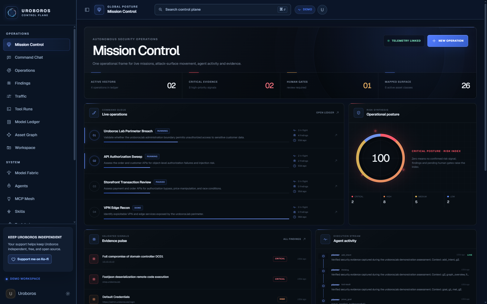
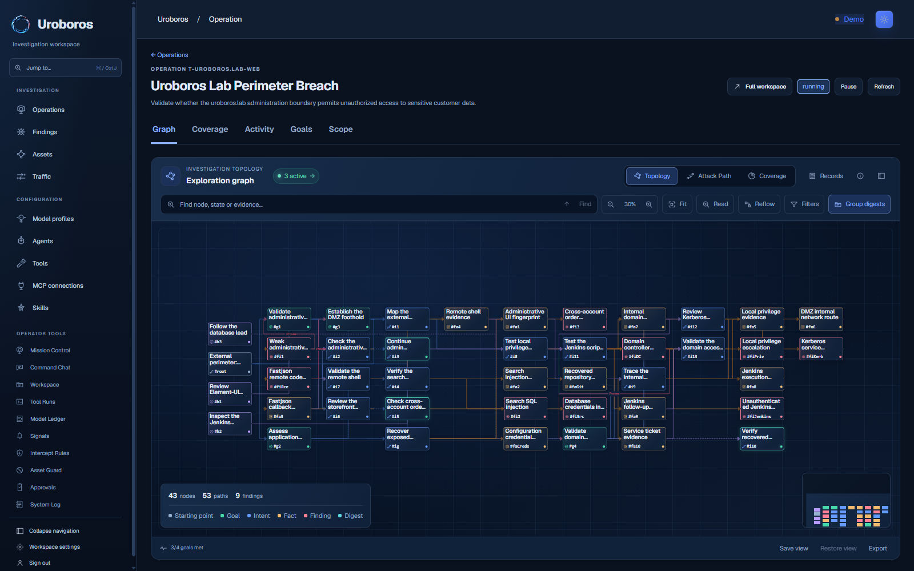

# Uroboros 0.5

Uroboros is a local control plane for authorized security testing. It combines
agent orchestration, explicit scope, asset discovery, captured traffic, evidence,
findings and tool execution in one console.

- Repository and future releases: [nobanic/Uroboros](https://github.com/nobanic/Uroboros)
- Maintainer: [nobanic](https://github.com/nobanic)
- Start here: [Operator guide](guide/README.md)
- License: [GNU Affero General Public License](LICENSE)

Use Uroboros on systems you own or have explicit permission to test. Read the
[Responsible Use & Legal Notice](https://uroboros.run/legal.html?lang=en).



## What is included

- Go control plane with planners, workers, operation lifecycle and model routing;
- a blue console with Mission Control, the living evidence graph, Operations,
  Findings, Traffic, Tool Runs, Model Ledger and Command Chat;
- organization and asset management, scope checks, approvals and intercept rules;
- model profiles, agent bindings, MCP servers and product skills;
- Playwright Browser MCP and Chromium;
- pinned Katana discovery and backend-only Arsenal integrations, including
  HTTPx, ffuf, Nuclei, Arjun and passive WAF fingerprinting;
- per-operation **Automatic startup** choices for the initial Katana crawl and
  reconnaissance scout, with explicit agent tool use preserved;
- API Experiment Lab, source analysis and reviewed experiment artifacts;
- audited web and vulnerability research, plus isolated Tor research;
- offline binary triage through the exact pinned broker and worker images;
- the current [operator guide](guide/README.md) and matching UI screenshots.

The application is called **Uroboros**. The screenshots use synthetic
demonstration data; they do not describe an assessment of a real target.

## Installation requirements

| Host | Requirements |
| --- | --- |
| Windows | Windows 10/11 x86-64, Docker Desktop using Linux containers, Docker Compose v2 and PowerShell. |
| Linux | x86-64/AMD64 Linux, Docker Engine, Compose v2, Bash, curl, GNU grep with PCRE support and standard core utilities. |

The complete stack currently requires Linux AMD64 container images. Native
ARM64 installation of the full stack is not supported by the launchers.

The Go application container has a 4 GiB memory cap. Chromium, PostgreSQL and
the sidecars have their own resource needs; the cap is not the total stack
memory requirement. The first source build downloads pinned dependencies and
can take several minutes.

Check your Docker installation:

```text
docker version
docker compose version
docker info --format '{{.OSType}}/{{.Architecture}}'
```

The engine must report Linux and AMD64/x86-64.

## Windows quick start

Start Docker Desktop and open PowerShell in this directory.

For a Git checkout:

```powershell
git clone https://github.com/nobanic/Uroboros.git
Set-Location .\Uroboros
```

For a downloaded package, open the directory containing this README and
`clean\start.ps1`. A private repository requires your own Git authentication.

Run the preflight and then start:

```powershell
powershell -NoProfile -ExecutionPolicy Bypass -File .\clean\start.ps1 -PreflightOnly
powershell -NoProfile -ExecutionPolicy Bypass -File .\clean\start.ps1
```

Open <http://127.0.0.1:8805/>. On a new database the application opens `/setup/`.
Create the first local operator password, then configure your own model profile.

Check or stop the stack:

```powershell
powershell -NoProfile -ExecutionPolicy Bypass -File .\clean\status.ps1
powershell -NoProfile -ExecutionPolicy Bypass -File .\clean\stop.ps1
```

## Linux quick start

Install Docker Engine and the Compose v2 plugin for your distribution, and make
sure your account can access the Docker daemon. Enter the downloaded package or
clone the repository:

```bash
git clone https://github.com/nobanic/Uroboros.git
cd Uroboros
bash ./clean/start.sh --preflight-only
bash ./install.sh
```

Open <http://127.0.0.1:8805/>. Check or stop the stack with:

```bash
bash ./clean/status.sh
bash ./clean/stop.sh
```

`install.sh` delegates to `clean/start.sh`. These Bash entry points work after
plain directory copying as well as Git checkout; they do not rely on a ZIP
preserving executable permissions.

## Required binary runtime images

The full stack uses two exact audited binary-triage images. The repository
includes these offline Docker archives:

```text
clean/runtime-images/binary-broker-b05.tar
clean/runtime-images/binary-worker-b05.tar
```

Their sizes, SHA-256 checksums and image identities are recorded in
[the runtime image manifest](clean/runtime-images/MANIFEST.md). The launchers
accept the exact images already loaded in Docker, or verify and load the matching
archives. A changed archive or image identity is rejected.

Both archives are tracked as regular Git files. A repository clone or
GitHub-generated source ZIP includes them, so a fresh Docker host does not
need the two binary-triage images preloaded or downloaded separately. The
normal first source build still needs internet access for its pinned dependencies.

## Fresh state and persistence

This package contains no operator database, default account, password, JWT
signing key, LLM key or imported task history.

The launchers generate internal Docker credentials outside the source tree:

- Windows: `%LOCALAPPDATA%\Astra\runtime.env`;
- Linux: `${XDG_STATE_HOME:-$HOME/.local/state}/astra/runtime.env`.

Those established storage names are retained for compatibility. They do not
change the console name. An explicit `ASTRA_RUNTIME_DIR` can select a different
private state directory before installation.

The default Compose project is `uroboros`; the default UI port is `8805`. All
persistent application, PostgreSQL, sidecar, binary artifact and signing-key
data are kept in named volumes. The console is published only on loopback.

Stopping the stack preserves its named volumes. A source update or Git rollback
does not roll back persistent data. Back up affected data before a migration,
reset or configuration experiment. Do not delete volumes as a startup fix.

This package does not import data from an existing installation. When operating
an existing customized project, retain its exact project name, volume names,
private runtime file, port and overrides.

Changing the project name creates a separate set of containers, networks and
volumes. An existing installation using the older `astra` project needs a
data-preserving migration before starting under the new name. Keep its original
volumes and credentials until the migrated installation has been verified.

## First operation

1. Create and activate a profile in **Model Fabric**.
2. Review **Agents**, **Toolchain**, **MCP Mesh** and **Skills**. Tool availability
   is bound to roles; a tool shown in the catalog is not available to every worker.
3. Register only the target scope you are authorized to test.
4. Create an operation with a concrete goal and constraints.
5. Follow the graph, tool activity and main-agent conversation.
6. Review captured evidence before confirming findings or exporting a report.

The [operator guide](guide/README.md) walks through each step with current
screenshots, including graph search, the record browser and evidence inspection.



## Models, tools and research budgets

Provider credentials are configured by the operator in the console. Starting
the application does not configure or test a paid model. Connection tests and
real operations can make provider requests.

**Configuration → Search intelligence → Recorded failover & budgets** controls
the audited research broker. The default cumulative limit is 40 attempts per
operation and the default rate is 10 attempts per minute. This budget is shared
across agents and research tools, including vulnerability lookups. Failed
attempts and retries count; cache receipts do not.

Research limits, model token limits, paid request units and scanner budgets are
separate controls. Raising one does not change the others or authorize a wider
target scope. See [the budget explanation](guide/README.md#research-budgets).

## Source layout

| Area | Responsibility |
| --- | --- |
| `cmd/uroboros`, `server/` | Application entry point, HTTP API, orchestration and streaming. |
| `agent/`, `mission/`, `sidequestion/` | Agent roles, work lifecycle and auxiliary conversations. |
| `db/` | Persistent state, graph records, scopes, settings and audit data. |
| `web/` | Console source, assets and static frontend build. |
| `traffic/`, `intercept/`, `guard/` | Captured HTTP, policy and scope boundaries. |
| `katana/`, `arsenal/`, `api_lab/` | Discovery and controlled tool integrations. |
| `binary*` | Offline binary intake, storage, broker and worker components. |
| `mcphttp/`, `skills/`, `third_party/` | MCP transport, product skills and attributed dependencies. |
| `clean/` | Supported full-stack installation, private runtime state and image checks. |
| `guide/`, `screenshots/` | Operator documentation and its current illustrations. |

The product's `agent/` implementation and skills are part of the application.
Developer session instructions, private evaluation records and operator data are
not part of this package.

## Updates

The clean Docker installation updates from ordinary commits on
[nobanic/Uroboros → main](https://github.com/nobanic/Uroboros/tree/main).
Open **System settings → Version & Updates**, check for updates, then choose
**Update from main**. GitHub Releases and version tags are not required.

The installer builds the selected source first, requires idle/paused operations,
creates a private recovery backup, replaces the stack and verifies the new
source commit. Existing tasks, API profiles, settings and the signing key stay
with the installation. Source snapshots and backups remain outside the checkout.
See [console updater details and recovery](clean/updater/README.md).

An older installation needs one normal start with this updated source to add
the controller. Subsequent updates use the console. The legacy root `update.sh`
and native binary replacement are separate from this managed Docker workflow.

## Validation and boundaries

The application lineage has been exercised through a real Windows Docker
Desktop stack. The Linux launcher has separate real-Bash/Git-export preflight
coverage; a full cold installation on a fresh Linux Docker host remains a
separate check. The guide's UI captures use synthetic data, not live providers
or target scans.

This directory is a clean source distribution. `RELEASE_SOURCE` preserves its
source revision when Git metadata is absent. `RELEASE_MANIFEST.json` records
file hashes, screenshot provenance and included runtime archives. Runtime
credentials and databases remain outside the package.

For startup issues, follow [Troubleshooting](guide/README.md#troubleshooting)
and the [clean-stack documentation](clean/README.md). Preserve the
[license](LICENSE) and third-party notices when redistributing the application.
