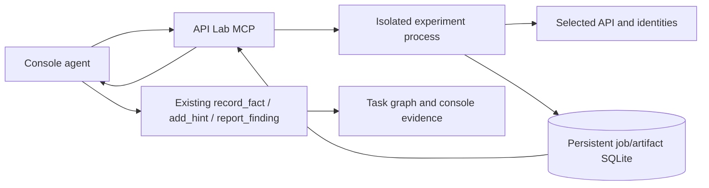

# API Experiment Lab

Standalone authenticated MCP service for the console's hypothesis → experiment
→ control → reproducible evidence workflow. It supports OpenAPI 3, JSON APIs,
named identities, actual response IDs, Schemathesis/Hypothesis input generation,
and explicit authorization/state assertions. No arbitrary model-written Python
is executed. Direct and transitive dependencies are pinned in requirements.lock;
the Python base image is pinned by digest.

## Start and connect

From the application root Uroboros/Uroboros, copy identities.example.json to the gitignored
bench/api-lab-identities.json if it does not exist. The example contains only
credentials for the disposable fixtures. Configure real target identity names,
exact origins and authentication headers in that operator-owned file; the
model receives references, not the configured tokens. v1 uses configured static
sessions; automatic account creation/login/credential refresh is future work.

```powershell
docker compose -f api_lab/docker-compose.api-lab.yml --env-file bench/.env --profile fixtures up -d --build
docker run --rm --network uroboros_net_dbnet --env-file bench/.env -e UROBOROS_BASE=http://uroboros-internet-firewall-1:8787 uroboros-api-lab/service:local python -m api_lab.register
```

The sidecar shares the existing internal lab network and exposes no host port.
The service uses ARSENAL_TOKEN from bench/.env as API_LAB_TOKEN in Compose.
Registration creates/refreshes the console's api_lab MCP entry and merges agent
visibility; existing servers, skills, credentials and agent prompts are retained.
API_LAB_AGENTS optionally selects the agents to authorize. The existing MCP
per-tool access UI applies. Start a new agent run/chat to use refreshed tools.
Fixtures are optional; omit --profile fixtures when testing other configured APIs.

## Tools and plans

Nineteen MCP tools: api_lab_catalog, api_lab_start, api_lab_status, api_lab_results,
api_lab_artifact, api_lab_replay, api_lab_cancel, api_lab_list, api_lab_export,
api_lab_replay_recipe, api_lab_import_traffic, api_lab_schema,
api_lab_source_projects, api_lab_source_scan, api_lab_source_status,
api_lab_source_results, api_lab_source_slice, api_lab_source_context,
api_lab_source_cancel.

## Runtime evidence graph contract (offline shadow only)

`runtime_evidence.py` defines the content-addressed
`uroboros-runtime-evidence-v1` graph batch and bounded offline adapters for:

- Katana JSONL crawl results;
- Schemathesis 4.31.1+ NDJSON engine events and recorded interactions;
- self-hosted Interactsh interaction JSONL;
- Nuclei `ResultEvent` JSONL with a pinned template-corpus hash.

The matching machine-readable contract is `runtime_evidence.schema.json`.
Each import contains a pinned tool/config/corpus manifest, exact input artifact
hash and size, per-record hashes, normalized nodes and provenance edges. Canonical
archive bytes have their own SHA-256 and are rejected on hash mismatch, mutation,
dangling edges, reordering or non-canonical restore.

Raw request/response strings, extracted results, commands, callback addresses and
correlation IDs are not copied into the graph. They are hashed; only header names
are retained and every query value is redacted. The immutable raw tool artifact must be
retained separately under the manifest's `input_artifact.sha256` if later replay
needs original bytes. Imports are fail-closed on out-of-scope target URLs, malformed
or duplicate JSON keys, size/record limits, unregistered OAST correlations and
disabled OAST protocols. FTP is not accepted by the first OAST contract.

External matches are never findings. Katana endpoints are derived candidates;
Schemathesis and Nuclei failures are hypotheses; an Interactsh callback proves only
the correlated interaction. API Lab controls and independent replay remain required
before finding confirmation.

The offline graph contract does not register an MCP tool, create a database
table, expose the graph to the planner, or alter normal agent behavior. VVAH is
not part of this black-box path. The active API Lab dependency is pinned at
Schemathesis 4.31.1, matching the verified NDJSON adapter contract. Run the
model-free contract tests with:

```powershell
python -m unittest api_lab.tests.test_runtime_evidence -v
```

## Katana one-shot shadow runner (operator only)

Phase 1 adds an explicitly invoked Katana 1.8.0 crawl outside MCP, the database,
the planner and normal agent execution. Katana remains a replaceable external
process; only its redacted, content-addressed evidence contract is repository
code. VVAH remains disabled and is neither invoked nor required.

The runner shares the selected Uroboros/firewall network namespace so it can use
the loopback recording proxy. A second loopback-only scope guard sits in front of
that proxy. It permits only the exact authorized origin and GET, HEAD or OPTIONS,
injects the proxy capture marker, and records rejected browser background or
state-changing requests. A Katana response becomes evidence only when it carries
a unique recording-proxy traffic ID. A guard rejection is coverage evidence only;
it cannot create an endpoint candidate, response observation or finding. Browser
discoveries without a response (including external CDN URLs emitted by headless
Katana after the guard blocks them) are retained only as hashed ignored-coverage
records. Extracted form actions and nested XHR hints likewise remain hashed
coverage until their own request receives proxy confirmation. An out-of-scope
response carrying a recording-proxy traffic ID remains a hard error because it
would contradict the network boundary.

The official Linux/amd64 image is pinned by manifest digest. The runner uses
`--pull never`, never builds an image, and fails if the required images or named
network container are absent. Provision them explicitly:

```powershell
docker pull --platform linux/amd64 docker.io/projectdiscovery/katana@sha256:92ccca6e268149d01dc5d8f628fcfc2fc4b0f932f5d4d5f93eb3f1ba9cc74bcf
docker build --pull=false --file api_lab/Dockerfile.katana-guard --tag uroboros-katana/scope-guard:local .
```

Inspect the canonical plan before executing it, then use a fresh run ID and an
operator-owned output directory:

```powershell
python -m api_lab.run_katana_shadow plan --target http://fixture:8080/ --target-revision fixture-v1 --scope-ref authorization:fixture --network-container uroboros-internet-firewall-1 --run-id katana-shadow-review-1 --mode standard
python -m api_lab.run_katana_shadow run --target http://fixture:8080/ --target-revision fixture-v1 --scope-ref authorization:fixture --network-container uroboros-internet-firewall-1 --run-id katana-shadow-review-1 --mode standard --output-dir C:\secure\katana-shadow-review-1
```

Raw JSONL is intentionally retained beside the redacted evidence and may contain
target data, so treat the output directory as sensitive. Files are never
overwritten. The container is read-only, capability-dropped, non-root,
`no-new-privileges`, and bounded by time, request, concurrency, response, PID,
memory and CPU limits. Headless mode additionally starts bundled Chromium. In
Phase 1 it is limited to controlled plain-HTTP targets because HTTPS CONNECT does
not let the outer guard inspect inner methods. Standard HTTPS requires an
explicit recording-proxy CA file via `--ca-file`. QUIC and non-proxied WebRTC UDP
are disabled in Chromium; the selected Uroboros/firewall namespace remains the
outer egress boundary for the untrusted browser process.

If the scope guard reaches the transaction limit, the runner can still archive
the bounded partial evidence, but marks its manifest `budget_exhausted` and
`truncated=true`. Such a run is explicitly incomplete and cannot support absence
or full-coverage claims.

The optional offline Traffic-to-spec bridge remains outside MCP, the database,
the planner and agents. A dedicated recorder export contains the bounded raw
request and response bodies; Katana evidence contributes only the
recording-proxy traffic IDs that may be selected. Proxy-only exchanges that are
not named by a Katana response are counted but ignored in this first bridge
version. Scope-guard transactions that do not finish with a recorder commit
(for example, because the browser cancels them) are reported separately; the
recorder count may be lower, but never higher, than the guard's allowed count.
The bridge requires complete Katana evidence, an exact matching run ID and
origin, every selected exchange, and the expected SHA-256 of both the evidence
bundle and recorder export. Each
selected recorder exchange must also match the method, redacted URL basis and
status linked in the Katana evidence graph. It makes no target request and
writes a new immutable OpenAPI 3.0.3 artifact without overwriting an existing
file:

```powershell
python -m api_lab.run_katana_traffic_schema `
  --evidence C:\secure\katana-run.evidence.json `
  --evidence-sha256 <bundle-sha256> `
  --recorder-export C:\secure\katana-run.recorder.jsonl `
  --recorder-sha256 <recorder-export-sha256> `
  --output C:\secure\katana-run.openapi.json
```

The raw recorder export is sensitive and stays outside Git. The OpenAPI embeds
observed paths, methods, statuses, parameter names and JSON shapes, plus
body/header hashes, selected traffic IDs and provenance. It does not infer
examples, required JSON fields, authentication policy or a finding. Authenticated
and stateful Schemathesis execution is handled only by the separately gated WFC
runner below.

Numeric and UUID path segments still begin as conservative `{path_N}`
placeholders. When one of those values has exactly one nonsensitive,
noncolliding response-leaf match in the existing dependency candidates,
Traffic-to-spec uses that leaf name (for example `{id}`) in the generated path.
The evidence records that the name came from an unverified dependency hint;
the candidate remains `verified: false` and is not promoted to an OpenAPI Link,
ownership rule, access policy, or finding. Ambiguous matches and operator-supplied
templates are never renamed.

For consumers that should receive only an explicitly named API surface, a
second offline command can project the immutable Traffic-to-spec artifact by
literal path prefix:

```powershell
python -m api_lab.run_traffic_schema_projection `
  --input C:\secure\katana-run.openapi.json `
  --input-sha256 <artifact-sha256> `
  --include-prefix /api `
  --include-prefix /rest `
  --output C:\secure\katana-run.api-only.openapi.json
```

The projector requires canonical, hash-matching input and filters paths,
traffic evidence and dependency candidates together. Prefixes are an explicit
operator allowlist: it does not infer which routes look like APIs and it does
not promote ignored proxy-only traffic. The original source provenance remains
embedded, while projection metadata records the source and selected counts and
states that evidence authority is unchanged. This command also remains outside
MCP, the database, the planner and agents, and makes no network or model call.

## Schemathesis one-shot shadow runner (operator only)

Phase 2 can execute either the complete canonical Traffic-to-spec artifact or
its validated explicit projection with Schemathesis 4.31.1. This remains a
manual, replaceable external process: it is not an MCP tool, is not stored in
the API Lab database, is not visible to the planner or agents, and makes no
model call. VVAH stays off.

The first execution boundary is deliberately anonymous and read-only. The
schema must name one canonical controlled HTTP origin and may contain only GET,
HEAD, or OPTIONS operations. External `$ref` values, HTTPS targets, redirects,
retries, stateful testing, credentials, WFC auth/report files, and write
operations are rejected or disabled. WFC here means the WebFuzzing Commons
authentication/report interchange; it does not add endpoint coverage by itself.
Authenticated stateful execution is a different command and contract below.

Every request goes through the same loopback exact-origin scope guard and
recording proxy used by the Katana shadow path. `--max-examples` is only a
per-operation setting, so the runner separately constrains the rate/time
envelope below the guard's hard transaction cap. A normal Schemathesis response
is target evidence only if it carries a unique recording-proxy traffic ID.
Guard-generated responses and interactions without a recorded response are
hashed coverage observations; their checks cannot become hypotheses. Even a
proxy-confirmed Schemathesis failure remains only a hypothesis pending API Lab
controls and independent replay. A time or failure budget stop is archived as
truncated evidence and cannot support an absence claim.

Build the already-pinned local service and guard images explicitly; the runner
itself uses `--pull never` and never builds:

```powershell
docker build --pull=false --file api_lab/Dockerfile --tag uroboros-api-lab/service:local .
docker build --pull=false --file api_lab/Dockerfile.katana-guard --tag uroboros-katana/scope-guard:local .
```

Inspect the hash-bound plan before a fresh run. The target must exactly match
the schema's single server origin, and the output directory contains sensitive
raw NDJSON/stdout/stderr that must remain outside Git:

```powershell
python -m api_lab.run_schemathesis_shadow plan `
  --schema C:\secure\katana-run.api-only.openapi.json `
  --schema-sha256 <artifact-sha256> `
  --target http://fixture:8080 `
  --target-revision fixture-v1 `
  --scope-ref authorization:fixture `
  --network-container uroboros-internet-firewall-1 `
  --run-id schemathesis-shadow-review-1

python -m api_lab.run_schemathesis_shadow run `
  --schema C:\secure\katana-run.api-only.openapi.json `
  --schema-sha256 <artifact-sha256> `
  --target http://fixture:8080 `
  --target-revision fixture-v1 `
  --scope-ref authorization:fixture `
  --network-container uroboros-internet-firewall-1 `
  --run-id schemathesis-shadow-review-1 `
  --output-dir C:\secure\schemathesis-shadow-review-1
```

The disposable internal-network smoke uses no LLM or paid API call:

```powershell
python -m unittest api_lab.tests.test_schemathesis_shadow api_lab.tests.test_runtime_evidence -v
python -m api_lab.verify_schemathesis_shadow --output-dir C:\secure\schemathesis-shadow-smoke
```

### Schemathesis stateful WFC shadow runner (operator only)

The authenticated runner is intentionally separate from the anonymous runner.
It executes positive stateful sequences and the Schemathesis
`object_level_authorization` check with two to eight explicitly selected API
Lab identity refs. It is still a manual external process: no MCP registration,
database write, planner visibility, model call, VVAH invocation, or automatic
finding promotion occurs.

This runner is state-changing. It therefore requires an explicit mutation
authorization reference and a reset/disposal reference in addition to the
ordinary scope reference. Version 1 accepts only one controlled HTTP origin,
fixed-header identities, an observed write operation, an observed GET, and an
unambiguous semantic response-to-GET path dependency such as `id -> {id}`.
HTTPS and login-endpoint auth remain disabled because the scope guard must see
and constrain every method.

The existing API Lab identity JSON is SHA-256 bound, filtered to the named
peers, and converted to WFC only inside a temporary directory. The scanner gets
read-only mounts of that ephemeral file, the frozen schema, and generated TOML.
The credentials and generated auth file are never archived. Output is sanitized
by Schemathesis and scrubbed again against the source credential values before
being written. Artifacts contain only identity refs, header names, and hashes.

The exact-origin guard defaults to read-only for Katana and the anonymous
runner. Only this WFC command supplies an attested method allowlist consisting
of methods in the frozen schema plus GET, HEAD, and OPTIONS. All accepted
requests still pass through the recording proxy and require unique traffic IDs
before becoming evidence.

Inspect the plan before executing it against a freshly reset or disposable
target:

```powershell
python -m api_lab.run_schemathesis_wfc plan `
  --schema C:\secure\traffic.openapi.json `
  --schema-sha256 <schema-sha256> `
  --identities C:\secure\identities.json `
  --identities-sha256 <identities-sha256> `
  --peer alice --peer bob `
  --target http://fixture:8080 `
  --target-revision fixture-v1 `
  --scope-ref authorization:fixture `
  --mutation-scope-ref authorization:fixture-mutations `
  --reset-ref reset:fresh-fixture `
  --network-container uroboros-recording-proxy-1 `
  --run-id schemathesis-wfc-review-1

python -m api_lab.run_schemathesis_wfc run `
  --schema C:\secure\traffic.openapi.json `
  --schema-sha256 <schema-sha256> `
  --identities C:\secure\identities.json `
  --identities-sha256 <identities-sha256> `
  --peer alice --peer bob `
  --target http://fixture:8080 `
  --target-revision fixture-v1 `
  --scope-ref authorization:fixture `
  --mutation-scope-ref authorization:fixture-mutations `
  --reset-ref reset:fresh-fixture `
  --network-container uroboros-recording-proxy-1 `
  --run-id schemathesis-wfc-review-1 `
  --output-dir C:\secure\schemathesis-wfc-review-1
```

A Schemathesis BOLA failure is imported as a proxy-confirmed hypothesis with
identity and state-transition provenance. It remains
`requires_api_lab_controls_and_replay`; the evidence claim count for findings
is hard-coded and validated as zero. A separately checkpointed offline bridge
can now translate the narrow eligible sequence into an unexecuted API Lab
private-read draft.

The paired vulnerable/fixed smoke is local and model-free. It creates a fresh
target for each mode and removes both targets and internal networks afterward:

```powershell
python -m unittest api_lab.tests.test_schemathesis_wfc api_lab.tests.test_katana_shadow -v
python -m api_lab.verify_schemathesis_wfc --output-dir C:\secure\schemathesis-wfc-smoke
```

### Offline WFC BOLA to API Lab private-read draft bridge

The WFC bridge consumes the canonical Traffic-to-spec schema, redacted raw
NDJSON, canonical runtime-evidence bundle, and a separate operator policy. All
four inputs are mandatory and SHA-256 bound. It accepts only the concrete
proxy-confirmed sequence `POST create -> owner GET -> peer GET -> anonymous
denial`, with distinct configured identities and a semantic response-to-path
dependency. It performs no request, database write, MCP registration, planner
update, model call, or automatic API Lab submission.

The schema can identify the producer, reader, object pointer, and path
parameter, but it cannot establish ownership or confidentiality policy. The
bridge therefore refuses to infer those fields. An operator-owned policy must
name the owner/principal pointer, private fields, claim, and policy source:

```json
{
  "contract": "uroboros-api-lab-private-read-policy-v1",
  "target_origin": "http://fixture:8080",
  "rules": [{
    "rule_id": "private-note",
    "producer_operation_id": "observed_post_...",
    "read_operation_id": "observed_get_...",
    "path_parameter": "id",
    "object_pointer": "/id",
    "principal_pointer": "/owner",
    "private_fields": ["/secret"],
    "claim": "A private note may only be read by its owner",
    "policy_source": "operator:documented-access-policy"
  }]
}
```

```powershell
python -m api_lab.run_schemathesis_wfc_api_lab `
  --schema C:\secure\traffic.openapi.json `
  --schema-sha256 <schema-sha256> `
  --report C:\secure\wfc.schemathesis.ndjson `
  --report-sha256 <report-sha256> `
  --evidence C:\secure\wfc.evidence.json `
  --evidence-sha256 <evidence-sha256> `
  --policy C:\secure\private-read-policy.json `
  --policy-sha256 <policy-sha256> `
  --output C:\secure\wfc.api-lab-proposals.json

python -m unittest api_lab.tests.test_schemathesis_wfc_api_lab -v
```

The output copies neither WFC request values nor credential values. It builds
two synthetic create controls, owner and peer reads of their own objects, and
one `private_read` check. The plan remains `draft_experiment`; it has no cleanup
unless a later reviewed execution supplies one, so it must be run only against
an explicitly resettable or disposable target. Positive WFC evidence may be
translated even when a bounded run is truncated, but truncation can never
support an absence claim. Findings and confirmed-vulnerability counts remain
hard-coded and validated as zero.

### Operator-reviewed WFC draft intake

The next boundary is a bearer-authenticated operator route at
`POST /operator/wfc-intake`. It is hosted by the existing API Lab process and
uses the existing jobs, events, artifacts, traffic-schema and replay tables. It
is not an MCP tool, does not change the nineteen-tool catalog, is not visible to
the planner, and never reports or confirms a finding.

An initial request contains exactly one canonical proposal bundle, its selected
`proposal_id`, the canonical Traffic-to-spec schema, and a separate canonical
`uroboros-wfc-api-lab-execution-review-v1` document. Every artifact has an
expected SHA-256. The review binds the proposal, schema, report, runtime
evidence, operator policy, current identity-file bytes, final plan, target
origin/revision, scope/mutation/reset/cleanup references, and execution limits.
The target must be declared `disposable` or `resettable`. A resettable target
must include in-plan cleanup; version 1 accepts only observed DELETE operations
whose path values are response references. A disposable target may use external
disposal instead, but still requires an explicit `cleanup_ref`. Literal cleanup
bodies are rejected so the intake cannot archive WFC values or new secrets.

The review has these fields (shown with placeholders; this is not an approval):

```json
{
  "contract": "uroboros-wfc-api-lab-execution-review-v1",
  "action": "start",
  "decision": "REVIEW_REQUIRED",
  "reviewer_ref": "operator:REPLACE_ME",
  "reviewed_at": "REPLACE_ME",
  "proposal_bundle_sha256": "<sha256>",
  "proposal_id": "<sha256>",
  "schema_artifact_sha256": "<sha256>",
  "plan_sha256": "<sha256-of-proposal-plan-plus-cleanup>",
  "identity_config_sha256": "<sha256>",
  "source_recipe_sha256": null,
  "evidence": {
    "schemathesis_report_sha256": "<sha256>",
    "runtime_evidence_sha256": "<sha256>",
    "policy_artifact_sha256": "<sha256>"
  },
  "target": {
    "origin": "http://fixture:8080",
    "revision": "fixture-v1",
    "disposition": "disposable",
    "scope_ref": "authorization:fixture",
    "mutation_scope_ref": "authorization:fixture-mutations",
    "reset_ref": "reset:fresh-fixture",
    "cleanup_ref": "disposal:remove-fixture-after-job"
  },
  "execution": {
    "budget_seconds": 60,
    "max_requests": 40,
    "rps": 5,
    "request_timeout": 5,
    "seed": 1
  },
  "cleanup": []
}
```

After filling the reviewer, timestamp and hashes and changing `decision` to
`approved_for_execution`, validate locally before submitting. `plan` performs no
network request or database write; `run` sends the same documents to the API Lab,
which validates them again before creating a normal background job:

```powershell
python -m api_lab.run_wfc_api_lab_intake plan `
  --proposal C:\secure\wfc.api-lab-proposals.json `
  --proposal-sha256 <proposal-sha256> `
  --proposal-id <proposal-id> `
  --schema C:\secure\traffic.openapi.json `
  --schema-sha256 <schema-sha256> `
  --review C:\secure\wfc.api-lab-review.json `
  --review-sha256 <review-sha256> `
  --identities C:\secure\api-lab-identities.json

```

For submission, repeat the same command with `run` instead of `plan` and add
`--api-lab-url http://api-lab:8010`.

The bearer token is read from `API_LAB_TOKEN` by default and is never accepted
on the command line. The service's current `API_LAB_IDENTITIES` bytes must match
the reviewed WFC identity hash both at intake and again in the isolated worker.
Use the ordinary `api_lab_status`, results,
artifact and export tools after submission. The job archives only redacted
intake/review provenance alongside the normal schema, plan, controls and recipe.

A WFC reproducer cannot be sent through the generic MCP replay tools. Export the
complete `reproducer-*` artifact through all `api_lab_artifact` pages, create a
fresh review with `action: replay`, the new
target/reset/cleanup references and `source_recipe_sha256` equal to the exported
recipe hash, then use `plan-replay` and `replay`. The replay request contains the
schema and plan itself and works after the original API Lab job and all WFC input
artifacts are absent; no hidden scanner job is consulted. A vulnerable violation
or fixed passing control remains API Lab evidence only and does not change finding
state.

```powershell
python -m unittest api_lab.tests.test_wfc_api_lab_intake -v
```

Validation recorded on 2026-10-19 for implementation commit
`b30c81723b975a7cb8f087d357fbeb30496cb463` used an isolated host virtual
environment installed from `api_lab/requirements.lock`. The dedicated intake,
WFC bridge and engine command completed **19/19** tests in 7.333 seconds. It ran
the disposable local `fixture-v1` target, observed the reviewed private-read
violation, removed the original jobs/artifacts/schema rows, and replayed only the
exported recipe against independent `fixed-v1`, where the control passed with
zero violations. The isolated authenticated MCP lifecycle regression completed
**1/1** in 3.238 seconds and retained the existing nineteen-tool catalog.
`py_compile`, `git diff --check`, and the CLI help/import smoke also passed.

The full pinned Docker suite was not rerun for this commit because the local
Docker daemon was stopped; it was not started as part of source validation. A
host-wide discovery attempt is non-authoritative here: four source-scan tests
need the image's pinned `/opt/semgrep/bin/semgrep`, and the first Windows
loopback authorization probe has an existing startup race. The affected MCP
test passes when run in isolation as recorded above. No live runtime, external
target, paid model, finding state, or production database was touched.

### Offline Schemathesis to API Lab draft bridge

A separate one-shot command can turn a narrowly eligible Schemathesis server
error into an API Lab **draft** plan. It consumes the original canonical
Traffic-to-spec artifact, raw NDJSON report, and canonical runtime-evidence
bundle; all three inputs are mandatory and SHA-256 bound. It performs no
network request, database write, MCP registration, planner update, or model
call, and it never executes the resulting plan.

Version 1 accepts only anonymous, recording-proxy-confirmed, query-only GET
cases on literal paths. The response must be 5xx and have a matching
`not_a_server_error` hypothesis in the evidence graph. Request bodies,
credential headers, identity-bearing cases, sensitive parameters, dynamic
paths, write methods, and unsupported query schemas are not exported.
Undeclared fuzz parameters are removed; only schema-declared string parameters
enter the candidate step. The paired positive control is deterministic but is
still only a proposed control. API Lab must execute both steps and independently
replay the violation before an operator can assess impact. A reproducible 5xx
alone is not a confirmed security finding.

```powershell
python -m api_lab.run_schemathesis_api_lab `
  --schema C:\secure\katana-run.api-only.openapi.json `
  --schema-sha256 <schema-artifact-sha256> `
  --report C:\secure\schemathesis-run.schemathesis.ndjson `
  --report-sha256 <raw-report-sha256> `
  --evidence C:\secure\schemathesis-run.evidence.json `
  --evidence-sha256 <evidence-bundle-sha256> `
  --output C:\secure\schemathesis-run.api-lab-proposals.json

python -m unittest api_lab.tests.test_schemathesis_api_lab -v
```

The output remains outside Git and outside all model-facing mounts. Its entries
are marked `draft_experiment` and
`requires_operator_review_and_independent_api_lab_replay`; summary claim counts
are hard-coded and validated as zero. This command remains anonymous-only;
stateful WFC BOLA uses the separate policy-gated bridge above. Automatic API
Lab submission remains a later, separately checkpointed gate.

The disposable, internal-network smoke gate exercises both standard and headless
modes without a model or paid API call:

```powershell
docker build --pull=false --file api_lab/Dockerfile.katana-fixture --tag uroboros-katana/fixture:local .
python -m unittest api_lab.tests.test_katana_shadow api_lab.tests.test_runtime_evidence -v
python -m api_lab.verify_katana_shadow --output-dir C:\secure\katana-shadow-smoke
```

Promotion into MCP/core is deliberately a later gate: first compare coverage,
noise and runtime cost on representative black-box targets, then expose normalized
evidence with proxy-confirmed response lineage behind a feature flag. Discovery-only
candidates must remain visibly distinct from recorded responses. The scanner
process should remain isolated even if orchestration later moves into core.

## Source analysis to runtime evidence

The first source adapter uses **Semgrep Community Edition 1.180.0**, pinned with
all dependencies in `semgrep.lock` and installed in its own virtual environment.
API Lab's existing dependencies stay in their original environment. The adapter
runs local rules, disables metrics/version checks, and does not invoke source
builds, autofixes or remote registry rules. See the upstream
[CLI reference](https://docs.semgrep.dev/cli-reference) and
[pinned release](https://github.com/semgrep/semgrep/releases/tag/v1.180.0).

Compose mounts the selected console checkout at `/sources/uroboros:ro`.
`source_projects.json` is operator configuration for named roots, default paths,
source extensions, excluded directories and optional revision labels. Add other
read-only mounts and project entries for other source targets. The default
selection covers `agent`, `server`, `web/src` and the disposable API fixture.

1. Call `api_lab_source_projects`, then `api_lab_source_scan(project=...)`.
   Optional relative `paths` narrows the selection. Optional `rules` accepts a
   local Semgrep rules object tailored to a hypothesis. Resource budgets are
   explicit parameters; `max_source_bytes=0` removes the snapshot byte cap.
2. Poll `api_lab_source_status`, then page `api_lab_source_results`. Candidate
   locations, rule IDs and file hashes describe **static review candidates**.
   Scanner severity is not verified security impact. Inspect incomplete scans,
   errors and scanned paths; absence of matches is not a safety conclusion.
3. Select a candidate with `api_lab_source_slice`. `context_lines` includes
   surrounding access/route logic, and `related_paths` adds complete selected
   snapshot files for caller/config context. `api_lab_source_context` pages the
   immutable context. The files come from the scan snapshot, not a later checkout.
4. Establish the actual deployment/route and expected policy. Build concrete
   operations and explicit positive/negative controls in the normal experiment
   plan. Pass `source_context_id` to `api_lab_start`; optionally use an inferred
   traffic `schema_id` as well. The service loads original context directly.
5. Use the existing `bind_finding_experiment` and normal retest workflow. Export
   contains a `source-context` artifact alongside schema, plan, original HTTP
   requests/responses and controls. Reproducer recipes retain the same context;
   replay does not need the old source scan or context-store entry.

Source revision is the canonical hash of selected path/file-hash pairs, including
uncommitted files. An operator revision label is recorded separately and is not
assumed to be a verified Git commit or runtime deployment revision. Every source
slice has a full-file hash, original line range, exact byte hash and base64 bytes.
Source evidence preserves original program data, including string literals;
runtime HTTP credential redaction remains active. Static source provenance and
runtime security observations remain distinct evidence.

The bundled rules include Go/JavaScript request-to-shell taint candidates and a
Python object-response review anchor. The latter deliberately does not claim
that an authorization check is missing. Semgrep CE results/traces cover what the
selected rules and engine actually observed; they do not prove full call-graph
reachability, business policy or that source matches a running deployment.

Source jobs run independently of HTTP experiment jobs, survive MCP disconnects,
and are interrupted rather than resumed after a service restart. Scans and
original file bytes live in SQLite alongside the existing Lab data. Selected
source contexts are immutable and survive removal of scan history. Source-only
matches do not create findings, change triage or perform target requests.

```powershell
docker run --rm uroboros-api-lab/service:local python -m unittest api_lab.tests.test_source_scan -v
```

`python -m api_lab.verify_source_runtime` verifies the new source/MCP/experiment
and export/replay chain on the disposable fixtures, then scans the configured
console Go/TS selections and a separate Go selection. It reports parser
diagnostics and partial coverage on the broad selection. It uses no LLM and reads
no earlier job reports.

## Captured traffic to schema to test

When the target has no OpenAPI document, use captured HTTP exchanges:

1. Select traffic IDs for a single API origin using `traffic_search`.
2. Call the console host tool `api_schema_from_traffic` with `base_url` and
   `exchange_ids`. The host reads complete original captures, including blob
   bodies, and sends observations directly to the configured API Lab MCP.
3. Pass the returned `schema_id` to `api_lab_catalog`, then to `api_lab_start`
   with a normal explicit experiment plan. Omit `schema_url` when using an ID.
4. Use the existing finding attachment and retest workflow. Job evidence and
   replay recipes contain the frozen schema, so an archived replay works even
   after the original sidecar job and imported schema are gone.

```json
{
  "base_url": "https://api.example.test/v1",
  "exchange_ids": ["captured-create", "captured-read"],
  "path_templates": {"/notes/note-a": "/notes/{id}"},
  "identity_refs": {"captured-create": "alice", "captured-read": "alice"}
}
```

Numeric and UUID path segments are generalized automatically. Other segments
stay literal unless an explicit `path_templates` mapping is supplied; mappings
must match captured paths. Identity references are supplied knowledge, never
guessed from credential values. Captures from different origins are rejected
rather than silently mixed. The engine supports the selected base URL's path
prefix, and inferred operation paths are relative to that prefix.

The output is OpenAPI 3.0.3 with operation/parameter/JSON-field traffic references,
original request/response body and header hashes, observed timestamps and
identity references. Response value matches in later path/query/body arguments
produce **unverified dependency candidates** with JSON pointers. They help build
`$from` references; a matching value alone does not prove a causal dependency.
No JSON examples, auth headers or credential query values are stored in schemas.
The host redacts named credential body fields before transmission; the Lab also
redacts configured identity secrets. The source capture itself is unchanged.

Imported schemas have `schema_id` equal to their canonical JSON SHA-256 and
persist in SQLite independently of the last-100-job retention. `api_lab_schema`
pages the original document with a whole-document hash. Imports are immutable
and idempotent: selecting different observations creates a new version.
Authenticated `POST /api/traffic/schema` exposes the same host operation to API
clients. Agent calls respect existing host-tool bindings, MCP server visibility,
enabled state and the `api_lab_import_traffic` per-tool setting.

Only observed operations, statuses and JSON shapes are inferred. JSON required
fields, value limits, authorization policy and comprehensive coverage are not
inferred. A frozen observed schema is not proof that a replay deployment has
the same live API contract; review deployment/role compatibility and controls.
Checks and their policy source remain explicit. Non-JSON bodies contribute
metadata/statuses but no invented JSON shape. Oversized captures fail visibly;
raise `max_body_bytes` (default 1 MiB per side) to read complete larger bodies.
`api_lab_import_traffic` also accepts observations directly, but supplied source
labels do not authenticate them as console traffic; prefer the host bridge.

Targeted extension tests:

```powershell
docker run --rm uroboros-api-lab/service:local python -m unittest api_lab.tests.test_traffic_schema -v
```

For a live extension smoke against the disposable Compose fixtures, run
`python -m api_lab.verify_traffic_schema` from the console network namespace
with `ADMIN_PASSWORD`, `ARSENAL_TOKEN` and `UROBOROS_BASE` configured. It captures
four fresh requests through the recording proxy, imports their schema through
the console API, and executes/replays a new experiment with that schema.
It does not use an LLM or read earlier job reports.

## Experiment plans

Catalog exposes operation IDs, parameters, bodies, responses and identity names.
Plans contain steps, checks and optional cleanup. Each step names an OpenAPI
operation and identity. `$from` references a previous response JSON pointer;
`$nonce` produces fresh test data. `generate=true` draws schema-valid inputs
with Schemathesis/Hypothesis. Repeat examples to vary generated inputs; an
explicit fixed body remains fixed apart from declared references/nonces.
Execution order is all `steps`, then all `checks`, then top-level `cleanup`.
For `private_read`/`private_write`, steps are successful setup and positive
controls only. The engine automatically sends the anonymous and cross-principal
probe; do not add an expected 401/403/404 attack step or `check.step`. Put object
deletes/restores in `cleanup`, because a delete in `steps` runs before the oracle.

```json
{
  "name": "owner_read",
  "operation_id": "getNote",
  "identity": "alice",
  "path_parameters": {"id": {"$from": "owner_create#/id"}},
  "expected_status": 200
}
```

Full runnable fixture plans are returned by api_lab.fixture.example_plan();
see that function for creation, two successful owner controls and cleanup.
private_read requires different observed principals, the actual object ID and
explicit private fields. A peer can leak a field only when it matches owner
data, differs from the peer's own control data and belongs to the same object.
An anonymous-equivalent response is inconclusive rather than an assumed BOLA.
private_write checks owner readback after a peer mutation, a legitimate owner
mutation, and restoration/readback. json_equal/status support declared business
workflow expectations and a successful control. The policy source is explicit;
model assumptions are not silently converted into authoritative application policy.

Verdicts are passed/violation/inconclusive. A violation is evidence of the
declared invariant being broken, not automatically a confirmed vulnerability
or a novel zero-day. Schema issues are recorded separately. Blocking errors,
missing preconditions or exhausted execution budgets never become clean results.

## Jobs, artifacts and console evidence



Background jobs survive MCP disconnects. Restart marks unfinished jobs
interrupted and preserves produced evidence; no automatic rescan. Cancellation
kills the worker process tree. Target mutations may survive forced interruption,
so cleanup operations must target disposable test objects and be reviewed on a
partial run. This service does not claim to snapshot/reset arbitrary target data.

The named volume uroboros-api-lab_api_lab_data stores
/var/lib/api-lab/jobs.sqlite3: jobs, events and hashed artifacts. Last 100 jobs
are retained; deleting the volume removes their evidence. stdout/stderr caps
are 4 MiB each; response reads are bounded to 1 MiB. Request/rate/time/example
budgets are arguments, independent of MCP transport deadlines. One active job
is allowed; duplicate starts return busy with the current job ID.

Result pages contain compact oracles and request references (event:N). Artifact
pages expose credential-redacted requests/responses, complete schemas, plans
and replay recipes with canonical hashes, target/schema/tool/source revisions.
Minimization removes unrelated declared steps and runtime-verifies the slice;
hidden state dependencies cause fallback to the full recipe. Global minimality
is not claimed. Replay rebinds identities and recreates resources from dynamic
response references; a changed verdict on another deployment requires comparable
preconditions, schema/revision review and successful controls.

task_id/intent_id remain supplied provenance labels, not authenticated task context.
The console now provides bind_finding_experiment(finding_id, job_id, artifact_name).
After reviewing and reporting a candidate, call it with the standalone finding ID
and selected reproducer name. The host fetches the whole terminal job directly via
api_lab_export, validates canonical bundle/artifact hashes and stores the original
bytes in PostgreSQL finding_experiments. Requests, controls, schema and recipe
survive Lab retention. Attachment is atomic/idempotent, increments evidence_version,
links experiment_refs into the graph, and does not change finding triage.

get_finding_experiments lists attachments or pages original evidence. Authenticated
REST routes expose GET/POST /api/exploration/findings/{id}/experiments and GET
/api/exploration/findings/{id}/experiments/{experiment} for the full JSON bundle.
Start a normal retest from finding details. Its immutable snapshot includes the
experiment IDs/hashes. replay_finding_experiment loads the archived recipe directly,
even after the originating sidecar job expires; it only accepts an attachment from
that session's snapshot. Poll the returned job, then record_api_lab_retest_result
with summary and policy_basis. The host archives replay evidence and compares the
recipe, API contract hash (excluding root servers), named authz oracle and completion.
Incomplete runs, failed controls, changed contracts and model-assumed policy are
inconclusive. Generic business-state assertions require separate security triage.

Only successful session completion can apply the retest result. A verified
private_read/private_write reproduction promotes pending/in_progress to confirmed;
a comparable passing retest can set fixed. Manual disposition changes made during
the session are preserved. Existing generic retests remain available. Neither an
attachment nor a scanner severity alone confirms a vulnerability. Application
policy and comparable deployment/roles still require review; a free-text policy
label is not independently authenticated. Source and replay evidence/hashes remain
stored even when the final conclusion is inconclusive. Task archives retain original
experiments, retest history and replay evidence; restored historical conversations
are detached and interrupted retests are not resumed.

The task Markdown report now counts confirmed findings from standalone triage
status rather than the exploration-node state, with recorded/status counts shown.

## Verification

```powershell
docker run --rm -v "${PWD}:/src:ro" -w /src uroboros-api-lab/service:local python -m unittest discover -s api_lab/tests
docker exec uroboros-api-lab-api-lab-1 python -m api_lab.verify_live
```

Tests use a small disposable API with identical vulnerable/fixed schemas, two
identities and private notes. They cover both read/write violations, controls,
state assertions, generated bodies, verified dependency slices, hashes, redaction,
MCP auth/discovery/reconnect, cancellation and database restart preservation.
The live smoke test repeats native MCP read/write experiments and replays each
against the fixed Compose fixture. It does not exercise paid LLM judgment or
establish general vulnerability-discovery performance.

The eval driver was corrected separately to send snake_case task options matching
the Go API. Run eval/tests before measuring before/after performance; actual
LLM experiments still require a chosen model, comparable targets and budget.

`python -m api_lab.verify_console --variant vulnerable --budget-seconds 180`
is an optional paid-model workflow smoke via the console's configured profile.
Use the same command with fixed for the control. Provide ADMIN_PASSWORD and
UROBOROS_BASE at runtime; it prints no configured secret. Queue wait has its own
limit (`--queue-timeout-seconds`) and does not consume the model's strict execution
budget. The harness pauses unfinished tasks at that deadline and writes a unique,
immutable result file. Standalone findings and bound experiment metadata are filtered by task and
their timestamps; later task continuation is deliberately excluded from the old
attempt and must be recorded as a separate recovery run. A vulnerable attempt
passes only with both a finding and a bound experiment before cutoff. A fixed
control passes only when it finishes cleanly with no finding. Use `--result-dir`
to put the result in a persistent mounted directory. Fixture names reveal
variants; this is not a blinded discovery benchmark. On 2026-10-14, task 11 with deepseek-v4-pro
produced a completed read-ownership violation experiment, but timed out before
finding/evidence handoff. This does not establish successful autonomous reporting
inside the original 180-second attempt. A later manual continuation recorded
finding 74 and bound read/write experiments, but remains a separate recovery
result. On 2026-10-15, both model-generated recipes passed against `fixed-v1`
with zero violations; this validates the recipes as controls but is not a paid
fixed-model run and does not change finding triage. See the integration log in
../../memory/uroboros-api-lab-integration-2026-10-14.md.

The 2026-10-15 strict rerun also exposed two harness/plan-usability failures.
Attempt task 12 was invalid because queue wait consumed its old wall-clock budget;
schema v3 now starts the execution clock only after `running`. Task 13 then got a
full 180 seconds but failed the workflow: the model placed a denied peer request
in setup, so the vulnerable 200 response aborted the job before its oracle. The
deployed validator now rejects that shape before job creation, and catalog/tool
guidance states that private peer and anonymous probes are generated by the Lab.
The post-fix task 14 then completed autonomously in 125 seconds of execution:
one high pending BOLA finding, one bound reproducer, verified target cleanup and
no harness pause. Replaying that exact recipe against `fixed-v1` produced one
passing check and zero violations. This closes the fixture workflow calibration;
it remains a disclosed-variant smoke test, not a blind discovery benchmark.
