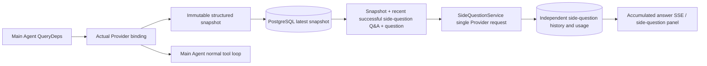

# Uroboros `/btw`

Ordinary chat, a task's MainAgent, and the current task's own Worker all support independent side-questions. Submit by typing `/btw question` in the main input box; an empty `/btw` or the "Side question" button opens the history. The desktop uses a resizable side panel; mobile uses a Drawer.

A side-question answer is generated from a snapshot of the Agent context taken at submission time, and supports streaming display, follow-ups, stop, and clear. Closing the panel, refreshing the page, or dropping the SSE connection does not cancel the model request. Stop affects only the current side-question; clear cancels the side-question and deletes the side-question history while preserving the main-context snapshot.

## Implementation boundary

Reuses Go, norma v0.3.7, Next.js, and the existing Markdown / ResizablePanel / Drawer / AlertDialog components; it does not modify norma's source or add dependencies for the side-question. The Planner, Workers inherited from other tasks, and tool-type subtask escalation are out of scope here.

- `capture.go` only marks main-loop requests in `Options.Deps.CallModel / CallModelSync`. The Provider decorator sits inside the concrete model, after the routing pool's outer selection, so it records the model actually selected; compaction and summary requests do not overwrite the snapshot.
- The snapshot is published at request start, at the complete model reply, and at the run's terminal state. A half-generated reply in progress is not published; tool calls stay paired via norma's `MessagesForAPI`, and tool results enter the snapshot on the next main-model request or at the terminal state. A streaming abort keeps the last valid boundary.
- The snapshot preserves structured messages, the system prompt, tool definitions, and generation parameters via a JSON deep copy. Model inference holds no snapshot lock or database transaction.
- `SideQuestionService` calls the concrete Provider; it first generates a side-question summary when necessary, and the final answer is allowed to shrink and retry only once — when the context first exceeds the limit and no text or tool call has yet been emitted. It creates no agent session and does not touch the tool executor, the main transcript, the activity stream, or the task graph, nor does it go through the task's model-switching chain. The answer keeps tool definitions for compatibility with the existing structured tool context; the summary request provides no tools. A newly returned tool call has no execution path.
- One running request per parent session, at most four per service process, with a 120-second timeout per call. The side-question uses an independent cancellation context under the service lifecycle.
- A side-question request keeps a reference to the model configuration and a non-sensitive identity digest; credentials are obtained from the existing configuration at request time. If the configuration is deleted, or identity fields such as the model, protocol, or address change, the main Agent must be run first to refresh the snapshot. Testing does not change the product's default model.

## Persistence and recovery

`db/schema.sql` automatically creates `side_question_sessions` and `side_question_requests`. The former stores the parent resource, the latest snapshot, the run number, the version, and the cleanup version; the latter stores the question, the accumulated answer, the status, the model, the snapshot time, usage, the event sequence number, and the pagination sequence number.

The parent-session key uses the conversation ID, or task ID + exploration ID + intent ID. Workers are not named by a reusable execution slot.

Snapshots are written merged per parent session, flushed every 250 ms, with the database comparing `(run_id, version)` to prevent an older version from overwriting a newer one. The selected snapshot is saved again right before the side-question is submitted. After a successful save the large in-memory snapshot is released; on failure the pending version is kept. The accumulated answer content is written at most every 250 ms as streaming events arrive, and the terminal state is saved immediately with limited retries on a database error.

On service startup, leftover `running` requests are marked `interrupted`, keeping the already-persisted partial answer and usage, and the request is not replayed automatically. The most recently saved context can be used directly for the next question. When an old session has no snapshot, the main Agent must be run first; the context is not rebuilt from the UI activity records.

A clear operation increments the cleanup version and deletes the requests; a conditional update blocks a late callback from writing back. Physical deletion of the parent resource relies on foreign-key cascade; a Worker's logical deletion removes the side-question data in the same transaction and rejects later late snapshots. Task archiving first blocks new requests, waits for the main flow to stop, then cancels and waits for the side-question to be persisted; the archive format is v3, and it is also compatible with v1/v2, which have no side-question tables.

History is preserved in full, returning at most 20 entries per page by a sequence-number cursor. A model request replays at most the raw text of the 20 most recent successful Q&A pairs, while also limiting the replay volume by token budget; older Q&A is maintained in an independent rolling summary. When the main context exceeds budget, only the old part of the side-question's copy is summarized, keeping recent structured tool calls and results. The summary, preparation progress, and usage are all subject to the side-question's concurrency, cancellation, and 120-second timeout limits.

## HTTP contract

The following paths serve as `{parent}`, reusing the existing authentication and resource validation:

- `/api/conversations/{id}`
- `/api/tasks/{id}/chat`
- `/api/tasks/{id}/intents/{iid}`

| Request | Response and behavior |
| --- | --- |
| `GET {parent}/side-questions?before={ordinal}` | `items` ordered newest to oldest, an independent `current` run status, `snapshot` metadata, and `next_cursor`; a cursor of 0 means the latest page / no next page |
| `POST {parent}/side-questions` | JSON `{ "question": "…", "client_request_id": "UUID" }`; a new request returns 202 with the request object; the same ID and question returns the existing object with 200 |
| `DELETE {parent}/side-questions` | cancels and clears the current parent session's side-question Q&A |
| `GET /api/side-questions/{requestID}/events` | `snapshot` SSE events, with `id` an incrementing sequence number and `data` the complete accumulated request object; a `cleared` event is sent on clear |
| `POST /api/side-questions/{requestID}/cancel` | explicit cancellation; the terminal state can be read from the history or SSE |

The question limit is 4000 characters. No snapshot, a model-configuration change, the same parent session being busy, or an idempotency-ID conflict returns 409; the global concurrency limit returns 429. Every SSE connection first sends the accumulated state and does not depend on text fragments the client received earlier. The frontend merges by request ID + sequence number, and discards stale callbacks when switching parent sessions or on clear.
